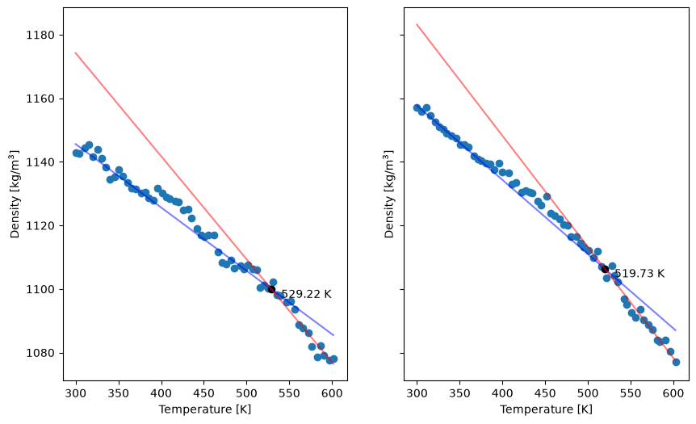

.. _badcy_postsim:

Post-build simulations and analyses
-----------------------------------

The canonical worked example for the postsim + analyze subsystems is
:ref:`tutorial 3 <tutorials_postsim_analyses>`; the workflow for
BADCy is identical save for the input filenames and a few
system-specific timings.  This page lists the postsim YAML and a few
BADCy-specific notes.

postsim.yaml
^^^^^^^^^^^^

.. code-block:: yaml

    - anneal:
        input_top: systems/final-results/final.top
        input_gro: systems/final-results/final.gro
        P: 1
        T0: 300
        T1: 600
        ncycles: 2
        T0_to_T1_ps: 10
        T1_ps: 10
        T1_to_T0_ps: 10
        T0_ps: 10
    - equilibrate:
        input_top: systems/final-results/final.top
        input_gro: postsim/anneal/anneal.gro
        T: 300
        ps: 10
    - ladder:
        input_top: systems/final-results/final.top
        input_gro: postsim/equilibrate/equilibrate.gro
        subdir: postsim/ladder-heat
        Tlo: 300
        Thi: 600
        deltaT: 5
        ps_per_rise: 10
        ps_per_run: 90
        warmup_ps: 10
    - ladder:
        input_top: systems/final-results/final.top
        input_gro: postsim/ladder-heat/ladder.gro
        subdir: postsim/ladder-cool
        Tlo: 300
        Thi: 600
        deltaT: -5
        ps_per_rise: 10
        ps_per_run: 90
        warmup_ps: 10
    - deform:
        input_top: systems/final-results/final.top
        input_gro: postsim/equilibrate/equilibrate.gro
        subdir: postsim/deform-x
        T: 300
        P: 1
        direction: x
        edot: 0.001
        ps: 40
        replicas: 3
    - deform:
        input_top: systems/final-results/final.top
        input_gro: postsim/equilibrate/equilibrate.gro
        subdir: postsim/deform-y
        T: 300
        P: 1
        direction: y
        edot: 0.001
        ps: 40
        replicas: 3
    - deform:
        input_top: systems/final-results/final.top
        input_gro: postsim/equilibrate/equilibrate.gro
        subdir: postsim/deform-z
        T: 300
        P: 1
        direction: z
        edot: 0.001
        ps: 40
        replicas: 3

Run it:

.. code-block:: console

    $ htpolynet postsim -cfg postsim.yaml -ocfg 6-cyanate-ester.yaml -proj proj-0

The numbers below come from the GPU reference build described on the
:ref:`results page <badcy_results>`.  Each ladder is 60 rungs of 100 ps, 6 ns in all,
and the whole post-build sequence took 30 minutes on one V100.  The moduli come from a
separate set of pulls on the same structure, described below.

Density
^^^^^^^

.. warning::

   The density the postcure stage ends at -- 1149.5 kg/m³ here -- is **not** an
   equilibrated density.  This example's postcure anneal peaks at 500 K, which is not
   clearly above this network's *T*:sub:`g` (see below), so it may never let the network
   rearrange.  On the reference build the cooling ladder, which starts at 600 K, ends at
   1157.0 kg/m³ at 300 K, 0.7 % denser.  Take densities from the cooling ladder, not
   from the end of the build.

``proj-0/postsim/anneal/rho_v_ns.png`` and ``proj-0/postsim/equilibrate/rho_v_ns.png``
show the density through the post-build anneal and equilibration.

Glass-transition temperature
^^^^^^^^^^^^^^^^^^^^^^^^^^^^

After ``postsim`` finishes, fit *T*:sub:`g` with:

.. code-block:: console

    $ htpolynet plots post --cfg postsim.yaml --proj proj-0

This writes ``tg.png`` and one CSV per ladder in ``proj-0/plots/``.

   Density vs. temperature on the heating ladder (left) and the cooling ladder (right),
   each with its glassy and rubbery fits.  *T*:sub:`g` is where the two lines cross.

**This protocol does not give a reproducible** *T*:sub:`g` **for this network, in either
direction.**  Five independent builds of this example (htpolynet-sweep, 2026-10-20, on
2.16.0), each run through the ladders above:

.. list-table::
   :header-rows: 1
   :widths: 30 35 35

   * -
     - Heating *T*:sub:`g`
     - Cooling *T*:sub:`g`
   * - Five builds, mean +/- s.d.
     - 401 +/- 32 K
     - 477 +/- 68 K
   * - Five builds, range
     - 384-458 K
     - 409-557 K
   * - Reference build (pictured)
     - 529.2 K
     - 519.7 K

An earlier version of this page recommended quoting the cooling value, because two
builds agreed on it to 10 K.  With five, cooling spreads over 150 K; the two that
agreed were both from its upper half.  ``plots post`` warned on every one of the five
builds -- twice because a cooling fit left the ladder's range, three times because
heating and cooling disagreed by 74-151 K -- and even the heating fits it did not warn
about move by 100-116 K across fit windows.

Two things about how these numbers arise:

- ``plots post`` logs the range of *T*:sub:`g` over fit windows of 10-25 points per side
  and warns when that range leaves the ladder's temperature span, or when heating and
  cooling differ by more than 50 K.  In the same five-build run of all six examples
  with a ladder, those warnings fired on 23 of 60 fits, and which direction failed
  varied by chemistry.
  **Read the warnings for every ladder; there is no direction that is safe by
  default.**  Polystyrene (example 1) was the one system clean on all ten fits.
- The heating ladder starts from the postcure structure after only a 10 ps
  equilibration.  A glass still densifying while it is heated loses density for a
  second reason, which flattens the region the glassy fit uses.  One earlier build of
  this example ended 19 kg/m³ lighter than the others and gave a heating *T*:sub:`g`
  of 332.5 K.

A wider ladder is what fixes it.  Five builds run on 100-700 K ladders
(htpolynet-sweep, 2026-10-25) give a cooling *T*:sub:`g` of 478 +/- 28 K from the
whole-curve fit ``plots post`` now reports beside the two-line one, with three of the
five builds clearing its checks on their own.  The heating direction is still refused:
its fitted transition does not end inside even that range.  Read the whole-curve line
of the log, quote its uncertainty and how many builds it kept, and widen the ladder
when it says the ladder does not reach past the transition.

When comparing with a DSC or DMA measurement, remember also that the ladder runs at
0.05 K/ps, many orders of magnitude faster than any experiment, and a faster rate
raises the apparent *T*:sub:`g`.

Young's modulus
^^^^^^^^^^^^^^^

``plots post`` also fits Young's modulus to the ``deform`` stages: it fits each pull --
every direction, every replica -- over ``fit_strain``, and reports *E* as the mean of
those fits with the standard error between them, writing ``e.png``, ``E.csv`` and the
individual fits to ``E-fits.csv``.

The ``deform`` stanzas above are the defaults, written out: each pull runs 40 ps at
``edot: 0.001`` to 4 % strain, *E* is fitted over 0.1-3 %, and each direction is pulled
three times, nine pulls in all.  Those defaults were chosen on this network.  Fifteen
pulls to 10 % strain -- five along each axis -- gave:

.. list-table::
   :header-rows: 1
   :widths: 30 40

   * - Direction
     - *E*, fitted over 0.1-3 % strain
   * - x
     - 3.33 ± 0.21 GPa
   * - y
     - 2.54 ± 0.23 GPa
   * - z
     - 2.13 ± 0.29 GPa
   * - all fifteen
     - **2.67 ± 0.19 GPa**

The directions differ by more than their error bars.  A box of 360 monomers is not
isotropic, so the overall figure is an isotropic estimate, and part of its error bar is
that anisotropy.  Fitted beyond about 4 % strain the slope falls -- 2.2 GPa to 5 %,
1.7 GPa to 8 % -- because the network starts to yield, so a wider window buys a smaller
error bar with a biased number.

Shorter pulls cannot resolve *E* at all.  The reference build's first postsim run used
10 ps pulls, reaching 1 % strain, and on a box of 13662 atoms the pressure fluctuates by
several hundred bar -- more than the stress a 1 % strain produces.  Fitted to 2 %, one
pull scattered by 80 %; to 3 %, by 30 %.

Free volume
^^^^^^^^^^^

Use ``htpolynet analyze`` to invoke ``gmx freevolume`` on the
equilibration trajectory.  Create ``fv.yaml``:

.. code-block:: yaml

    - command: freevolume

Then:

.. code-block:: console

    $ htpolynet analyze -cfg fv.yaml -proj proj-0

``proj-0/analyze/freevolume/ffv.dat`` reports a fractional free volume of
0.213 ± 0.001 for this build, with a molecular volume of 146.5 nm³ against a van der
Waals volume of 88.7 nm³.

A note on interpretation
^^^^^^^^^^^^^^^^^^^^^^^^

This network is at 97.5 % cyanate conversion, built by the reaction that cures the
real material.  Its 18 unreacted groups are intact -O-C#N end groups, which is what an
incompletely cured BADCy contains, so nothing about its composition is an artifact of
the model.  What remains model-dependent is the usual list for any simulated thermoset:
the GAFF force field with ``gas`` charges, a box of 360 monomers, a cure protocol whose
MD between iterations is far shorter than a real cure schedule, and properties measured
at simulation rates.
